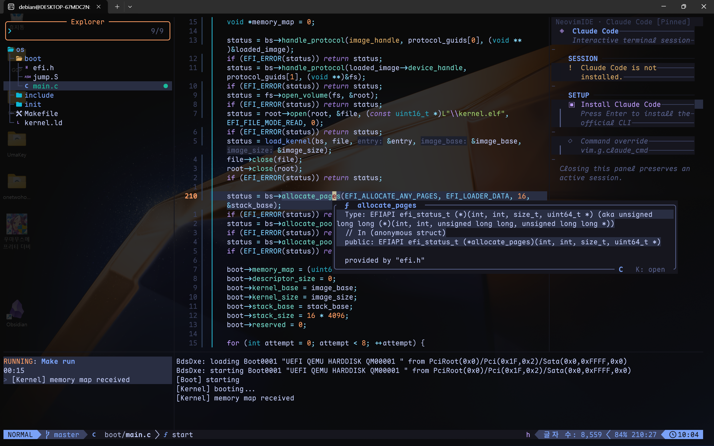

# [2026-10-31] NVIM 세팅기

---

요즘 위기의식과 경각심이 들고 있다.

일어나서 하는 거라곤 대충 AI에게 작업 시키고 멍때리면서 보고 있다가 뭔가 해냈다는 착각과 만족감과 함께 잠들고 있다.

이대로는 안 된다. 새로운 내가 필요하다.

그래서 그 시작으로 IDE부터 바꾸기로 했다. 이전부터 벼르고 있던 NeoVim으로 작업 환경을 구축하기.

사실 처음에는 맨땅에서 전부 만들어볼까 했는데, 배보다 배꼽이 큰 거 같기도 하고 뭣보다 이미 잘 돼 있는데 굳이? 싶어서 그냥 기성 플러그인 갖다가 조립해서 쓰고 있다.

물론 부족한 부분이 있는데 이 부분은 내가 만들어 쓰고 있다. 이게 NVIM의 힘...! 기능이 없어? 만들어. 이게 진정한 개발자 정신 아닐까.

> Q: 그냥 VSCode 쓰면 되지 않나요?

**알아.**

근데 이게 더 재밌잖아. 뭣보다 VSCode는 Vim을 제대로 활용할 수 없다. 커스텀도 상당한 제약이 있고.

그리고... 솔직히 좀 질리지 않는가. Rider도 좋은 IDE긴 한데 이건 너무 무겁고. 내가 맘대로 세팅할 수 있다 << 이게 제일 크다.

그리고 Vim << 이거 매우 편하다. 물론 처음 러닝 커브가 있는건 안다. 근데 이게 한번 적응하고 나면 이전 환경이 매우 불편한 역효과가 난다. 내가 왜 방향키로 손을 움직여야 하는데. hjkl 만세.

기능도 훨씬 많다. 어떤 변수를 선택한다? 마우스로 손을 움직여서 더블클릭. 하지만 Vim에선 vaa 끝. 와우.

코드 포메팅, 디버깅, Claude code, 빌드와 실행, git, 자동완성, 없는 기능이 없다. 설령 없다 하더라도 만들면 그만이다. 이런 엄청난 걸 모르는 당신들이 불쌍하다.

부수 효과로 내가 뭔가 고수가 된 기분이다. 일단 CMD 창에서 작업한다는게 뭐랄까 고수같고 괜히 어께가 올라가고 그런 느낌이다. 소위 말하는 꺼드럭이라고나 할까.

으흐흐. 이쁘다. 이걸 리눅스에서는 쌀질이라 한다고 한다. 나... 쌀질에 눈 떴을지도.

그래서 이걸로 요즘 뭘 하냐면... OS를 공부중이다. CS를 익히려면 결국 OS를 봐야 알겠더라고... 그래서 Linux 커널을 보려고 하는데 어디서부터 봐야할지 잘 모르겠다.

그냥 처음부터 만들면서 익히는게 더 나을지도 모르겠다.
